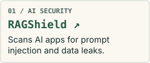
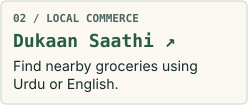
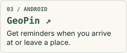
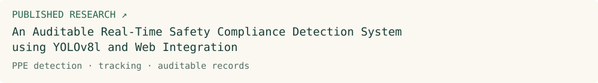

<picture>
  <source media="(max-width: 540px) and (prefers-color-scheme: dark)" srcset="./assets/workspace-dark-mobile.svg">
  <source media="(max-width: 540px) and (prefers-color-scheme: light)" srcset="./assets/workspace-light-mobile.svg">
  <source media="(prefers-color-scheme: dark)" srcset="./assets/workspace-dark.svg">
  <source media="(prefers-color-scheme: light)" srcset="./assets/workspace-light.svg">
  
</picture>

<a href="https://www.linkedin.com/in/umairaziz001/"><picture><source media="(prefers-color-scheme: dark)" srcset="./assets/badges/sage-linkedin-dark-v1.svg"></picture></a> <a href="https://ctf-writeups-webb.vercel.app/"><picture><source media="(prefers-color-scheme: dark)" srcset="./assets/badges/sage-writeups-dark-v1.svg"></picture></a> <a href="https://github.com/umair-aziz025/CTF_WRITEUPS"><picture><source media="(prefers-color-scheme: dark)" srcset="./assets/badges/sage-ctf-repository-dark-v1.svg"></picture></a> <a href="https://academia.edu.pk/index.php/Journals/article/view/2462"><picture><source media="(prefers-color-scheme: dark)" srcset="./assets/badges/sage-research-dark-v1.svg"></picture></a>

<picture>
  <source media="(max-width: 540px) and (prefers-color-scheme: dark)" srcset="./assets/radar-hunter-glow-dark-mobile.svg">
  <source media="(max-width: 540px) and (prefers-color-scheme: light)" srcset="./assets/radar-hunter-glow-light-mobile.svg">
  <source media="(prefers-color-scheme: dark)" srcset="./assets/radar-hunter-glow-dark.svg">
  <source media="(prefers-color-scheme: light)" srcset="./assets/radar-hunter-glow-light.svg">
  
</picture>

## Highlights

<a href="https://www.linkedin.com/posts/umairaziz001_technology-ai-entrepreneurship-share-7523290395037020160-LCn9/" title="NYLP AI Hackathon 2026: Winner. Dukaan Saathi · 1 Nov 2026. View LinkedIn post."><picture><source media="(prefers-color-scheme: dark)" srcset="./assets/badges/laurel-row-nylp-v7-dark.svg"></picture></a> <a href="https://www.linkedin.com/posts/umairaziz001_just-a-couple-of-challenges-famous-last-ugcPost-7515342912822530050-Ou7Y/" title="ZeroTrace CTF: Winner. 13,835 points · 3x3cu0r. View LinkedIn post."><picture><source media="(prefers-color-scheme: dark)" srcset="./assets/badges/laurel-row-zerotrace-v7-dark.svg"></picture></a> <a href="https://www.linkedin.com/posts/umairaziz001_a-little-late-to-post-but-still-riding-the-ugcPost-7407715571888209920-dpyB/" title="OffSec Echo Response: Winner. The Gauntlet · Season 1. View LinkedIn post."><picture><source media="(prefers-color-scheme: dark)" srcset="./assets/badges/laurel-row-echo-v7-dark.svg"></picture></a> <a href="https://www.linkedin.com/posts/umairaziz001_well-life-has-been-incredibly-busy-over-ugcPost-7452510300194476033-Yx6_/" title="OffSec Arctic Howl: Winner. The Gauntlet · Season 2. View LinkedIn post."><picture><source media="(prefers-color-scheme: dark)" srcset="./assets/badges/laurel-row-arctic-v7-dark.svg"></picture></a>

## Skills &amp; tools

<picture><source media="(prefers-color-scheme: dark)" srcset="./assets/badges/skill-v4-pentesting-dark.svg"></picture> <picture><source media="(prefers-color-scheme: dark)" srcset="./assets/badges/skill-v3-threat-hunting-dark-v1.svg"></picture> <picture><source media="(prefers-color-scheme: dark)" srcset="./assets/badges/skill-v3-incident-response-dark-v1.svg"></picture> <picture><source media="(prefers-color-scheme: dark)" srcset="./assets/badges/skill-v3-malware-analysis-dark-v1.svg"></picture> <picture><source media="(prefers-color-scheme: dark)" srcset="./assets/badges/skill-v3-reverse-engineering-dark-v1.svg"></picture> <picture><source media="(prefers-color-scheme: dark)" srcset="./assets/badges/skill-v3-machine-learning-dark-v1.svg"></picture> <picture><source media="(prefers-color-scheme: dark)" srcset="./assets/badges/skill-v3-computer-vision-dark-v1.svg"></picture> <picture><source media="(prefers-color-scheme: dark)" srcset="./assets/badges/skill-v3-object-detection-tracking-dark-v1.svg"></picture> <picture><source media="(prefers-color-scheme: dark)" srcset="./assets/badges/skill-v3-tensorflow-dark-v1.svg"></picture> <picture><source media="(prefers-color-scheme: dark)" srcset="./assets/badges/skill-v3-numpy-dark-v1.svg"></picture> <picture><source media="(prefers-color-scheme: dark)" srcset="./assets/badges/skill-v3-pandas-dark-v1.svg"></picture> <picture><source media="(prefers-color-scheme: dark)" srcset="./assets/badges/skill-v3-mediapipe-dark-v1.svg"></picture> <picture><source media="(prefers-color-scheme: dark)" srcset="./assets/badges/skill-v3-llm-integration-dark-v1.svg"></picture> <picture><source media="(prefers-color-scheme: dark)" srcset="./assets/badges/skill-v3-python-dark-v1.svg"></picture> <picture><source media="(prefers-color-scheme: dark)" srcset="./assets/badges/skill-v3-javascript-dark-v1.svg"></picture> <picture><source media="(prefers-color-scheme: dark)" srcset="./assets/badges/skill-v3-typescript-dark-v1.svg"></picture> <picture><source media="(prefers-color-scheme: dark)" srcset="./assets/badges/skill-v3-php-dark-v1.svg"></picture> <picture><source media="(prefers-color-scheme: dark)" srcset="./assets/badges/skill-v3-java-dark-v1.svg"></picture> <picture><source media="(prefers-color-scheme: dark)" srcset="./assets/badges/skill-v3-kotlin-dark-v1.svg"></picture> <picture><source media="(prefers-color-scheme: dark)" srcset="./assets/badges/skill-v3-solidity-dark-v1.svg"></picture> <picture><source media="(prefers-color-scheme: dark)" srcset="./assets/badges/skill-v3-react-dark-v1.svg"></picture> <picture><source media="(prefers-color-scheme: dark)" srcset="./assets/badges/skill-v3-react-native-dark-v1.svg"></picture> <picture><source media="(prefers-color-scheme: dark)" srcset="./assets/badges/skill-v3-expo-dark-v1.svg"></picture> <picture><source media="(prefers-color-scheme: dark)" srcset="./assets/badges/skill-v3-node-js-dark-v1.svg"></picture> <picture><source media="(prefers-color-scheme: dark)" srcset="./assets/badges/skill-v3-express-dark-v1.svg"></picture> <picture><source media="(prefers-color-scheme: dark)" srcset="./assets/badges/skill-v3-tailwind-css-dark-v1.svg"></picture> <picture><source media="(prefers-color-scheme: dark)" srcset="./assets/badges/skill-v3-android-studio-dark-v1.svg"></picture> <picture><source media="(prefers-color-scheme: dark)" srcset="./assets/badges/skill-v3-ipfs-dark-v1.svg"></picture> <picture><source media="(prefers-color-scheme: dark)" srcset="./assets/badges/skill-v3-ethers-js-dark-v1.svg"></picture> <picture><source media="(prefers-color-scheme: dark)" srcset="./assets/badges/skill-v3-burp-suite-dark-v1.svg"></picture> <picture><source media="(prefers-color-scheme: dark)" srcset="./assets/badges/skill-v3-owasp-zap-dark-v1.svg"></picture> <picture><source media="(prefers-color-scheme: dark)" srcset="./assets/badges/skill-v3-wireshark-dark-v1.svg"></picture> <picture><source media="(prefers-color-scheme: dark)" srcset="./assets/badges/skill-v3-ghidra-dark-v1.svg"></picture> <picture><source media="(prefers-color-scheme: dark)" srcset="./assets/badges/skill-v3-radare2-dark-v1.svg"></picture> <picture><source media="(prefers-color-scheme: dark)" srcset="./assets/badges/skill-v3-scapy-dark-v1.svg"></picture> <picture><source media="(prefers-color-scheme: dark)" srcset="./assets/badges/skill-v3-git-github-dark-v1.svg"></picture>

## Selected projects

I test web, API, mobile and Active Directory environments, and build AI/ML systems and full-stack applications.

<a href="https://github.com/umair-aziz025/RAGShield"><picture><source media="(prefers-color-scheme: dark)" srcset="./assets/cards/ragshield-dark.svg"><source media="(prefers-color-scheme: light)" srcset="./assets/cards/ragshield-light.svg"></picture></a> <a href="https://github.com/umair-aziz025/dukaan-saathi"><picture><source media="(prefers-color-scheme: dark)" srcset="./assets/cards/dukaan-saathi-dark.svg"><source media="(prefers-color-scheme: light)" srcset="./assets/cards/dukaan-saathi-light.svg"></picture></a> <a href="https://github.com/umair-aziz025/GeoPin"><picture><source media="(prefers-color-scheme: dark)" srcset="./assets/cards/geopin-dark.svg"><source media="(prefers-color-scheme: light)" srcset="./assets/cards/geopin-light.svg"></picture></a>

**More projects across AI/ML, security and development**

<a href="https://academia.edu.pk/index.php/Journals/article/view/2462"><picture><source media="(prefers-color-scheme: dark)" srcset="./assets/badges/project-v3-ppe-detection-final-year-ml-project-dark-v1.svg"></picture></a> <a href="https://github.com/umair-aziz025/ArchTech__Internship__Month_2"><picture><source media="(prefers-color-scheme: dark)" srcset="./assets/badges/project-v3-fraud-detection-ml-dark-v1.svg"></picture></a> <a href="https://github.com/umair-aziz025/NazarSaathi"><picture><source media="(prefers-color-scheme: dark)" srcset="./assets/badges/project-v3-nazarsaathi-vision-ocr-dark-v1.svg"></picture></a> <a href="https://github.com/umair-aziz025/CrisisGrid"><picture><source media="(prefers-color-scheme: dark)" srcset="./assets/badges/project-v3-crisisgrid-ai-agents-dark-v1.svg"></picture></a> <a href="https://github.com/umair-aziz025/dynamicframe-handtracking"><picture><source media="(prefers-color-scheme: dark)" srcset="./assets/badges/project-v3-hand-tracking-mediapipe-dark-v1.svg"></picture></a> <a href="https://github.com/umair-aziz025/pentest-audit-trail"><picture><source media="(prefers-color-scheme: dark)" srcset="./assets/badges/project-v3-pentest-audit-trail-blockchain-dark-v1.svg"></picture></a> <a href="https://github.com/umair-aziz025/ncp-portal"><picture><source media="(prefers-color-scheme: dark)" srcset="./assets/badges/project-v3-ncp-portal-php-mysql-dark-v1.svg"></picture></a> <a href="https://github.com/umair-aziz025/NarrativeHub"><picture><source media="(prefers-color-scheme: dark)" srcset="./assets/badges/project-v3-narrativehub-full-stack-dark-v1.svg"></picture></a>

Browse all public repositories — projects, labs and write-ups

- [ArchTech__Internship__Month_2](https://github.com/umair-aziz025/ArchTech__Internship__Month_2)
- [ArchTech_CyberSecurity_Internship_Tasks](https://github.com/umair-aziz025/ArchTech_CyberSecurity_Internship_Tasks)
- [arctic-howl-offsec-season2](https://github.com/umair-aziz025/arctic-howl-offsec-season2)
- [avantgarde_clone](https://github.com/umair-aziz025/avantgarde_clone)
- [Certified_Offensive_Windows_API_Exam](https://github.com/umair-aziz025/Certified_Offensive_Windows_API_Exam)
- [codeAlpha_CyberSecurity_Internship](https://github.com/umair-aziz025/codeAlpha_CyberSecurity_Internship)
- [CrisisGrid](https://github.com/umair-aziz025/CrisisGrid)
- [CTF_WRITEUPS](https://github.com/umair-aziz025/CTF_WRITEUPS)
- [CVE-2026-5281-Research-Toolkit](https://github.com/umair-aziz025/CVE-2026-5281-Research-Toolkit)
- [dahua-cve-research](https://github.com/umair-aziz025/dahua-cve-research)
- [Deltaware_solution_internship_task](https://github.com/umair-aziz025/Deltaware_solution_internship_task)
- [DevelopersHub_internship_tasks](https://github.com/umair-aziz025/DevelopersHub_internship_tasks)
- [dukaan-saathi](https://github.com/umair-aziz025/dukaan-saathi)
- [dune-phantom-offsec-Season3](https://github.com/umair-aziz025/dune-phantom-offsec-Season3)
- [dynamicframe-handtracking](https://github.com/umair-aziz025/dynamicframe-handtracking)
- [echo-response-offsec-challenge](https://github.com/umair-aziz025/echo-response-offsec-challenge)
- [Elevvo_Internship_tasks](https://github.com/umair-aziz025/Elevvo_Internship_tasks)
- [GeoPin](https://github.com/umair-aziz025/GeoPin)
- [htmlcss-edyodaproject](https://github.com/umair-aziz025/htmlcss-edyodaproject)
- [landlordapp-clone](https://github.com/umair-aziz025/landlordapp-clone)
- [LifeCarePharmacy-v12](https://github.com/umair-aziz025/LifeCarePharmacy-v12)
- [malware-analysis](https://github.com/umair-aziz025/malware-analysis)
- [NarrativeHub](https://github.com/umair-aziz025/NarrativeHub)
- [NazarSaathi](https://github.com/umair-aziz025/NazarSaathi)
- [ncp-portal](https://github.com/umair-aziz025/ncp-portal)
- [ncp-portal-v2](https://github.com/umair-aziz025/ncp-portal-v2)
- [pentest-audit-trail](https://github.com/umair-aziz025/pentest-audit-trail)
- [phishguard-learn](https://github.com/umair-aziz025/phishguard-learn)
- [PHP2Shell](https://github.com/umair-aziz025/PHP2Shell)
- [Prodigy_CS_01](https://github.com/umair-aziz025/Prodigy_CS_01)
- [Prodigy_CS_02](https://github.com/umair-aziz025/Prodigy_CS_02)
- [project-collection](https://github.com/umair-aziz025/project-collection)
- [RAGShield](https://github.com/umair-aziz025/RAGShield)
- [secure-production-app-intership-developershub](https://github.com/umair-aziz025/secure-production-app-intership-developershub)
- [THM-Advent-of-Cyber](https://github.com/umair-aziz025/THM-Advent-of-Cyber)
- [threat_hunting_incident_response_exam](https://github.com/umair-aziz025/threat_hunting_incident_response_exam)
- [web_dev](https://github.com/umair-aziz025/web_dev)
- [youngdev-internship-tasks](https://github.com/umair-aziz025/youngdev-internship-tasks)

## Research

My final-year project combined a trained YOLOv8l PPE detector, worker tracking, and a Flask/PostgreSQL dashboard for auditable safety monitoring. The published study reports 0.928 mAP@0.5 and a maximum F1 score of 0.94.

<a href="https://academia.edu.pk/index.php/Journals/article/view/2462"><picture><source media="(max-width: 740px) and (prefers-color-scheme: dark)" srcset="./assets/polish/paper-dark-mobile.svg"><source media="(max-width: 740px) and (prefers-color-scheme: light)" srcset="./assets/polish/paper-light-mobile.svg"><source media="(prefers-color-scheme: dark)" srcset="./assets/polish/paper-dark.svg"></picture></a>

## Pentest cycle

<picture>
  <source media="(max-width: 740px) and (prefers-color-scheme: dark)" srcset="./assets/cycle/flow-inset-v3-dark-mobile.svg">
  <source media="(max-width: 740px) and (prefers-color-scheme: light)" srcset="./assets/cycle/flow-inset-v3-light-mobile.svg">
  <source media="(prefers-color-scheme: dark)" srcset="./assets/cycle/flow-inset-v3-dark.svg">
  <source media="(prefers-color-scheme: light)" srcset="./assets/cycle/flow-inset-v3-light.svg">
  
</picture>

<!-- contribution-panel -->

## Contribution activity

<picture><source media="(prefers-color-scheme: dark)" srcset="./assets/contributions/activity-dark.svg"></picture>
