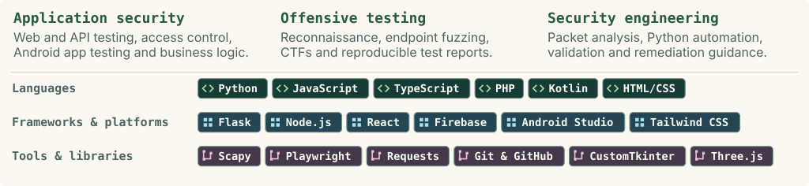

<picture>
  <source media="(max-width: 540px) and (prefers-color-scheme: dark)" srcset="./assets/workspace-dark-mobile.svg">
  <source media="(max-width: 540px) and (prefers-color-scheme: light)" srcset="./assets/workspace-light-mobile.svg">
  <source media="(prefers-color-scheme: dark)" srcset="./assets/workspace-dark.svg">
  <source media="(prefers-color-scheme: light)" srcset="./assets/workspace-light.svg">
  
</picture>

<picture>
  <source media="(max-width: 540px) and (prefers-color-scheme: dark)" srcset="./assets/radar-dark-mobile.svg">
  <source media="(max-width: 540px) and (prefers-color-scheme: light)" srcset="./assets/radar-light-mobile.svg">
  <source media="(prefers-color-scheme: dark)" srcset="./assets/radar-dark.svg">
  <source media="(prefers-color-scheme: light)" srcset="./assets/radar-light.svg">
  
</picture>

[Download the interactive workspace (.zip)](https://github.com/umair-aziz025/umair-aziz025/raw/refs/heads/main/downloads/retro-pixel-workspace.zip) · Unzip and open `workspace.html` to adjust the breeze or pause the scene.

## Skills &amp; tools

<picture><source media="(max-width: 740px) and (prefers-color-scheme: dark)" srcset="./assets/cards/skills-dark-mobile.svg"><source media="(max-width: 740px) and (prefers-color-scheme: light)" srcset="./assets/cards/skills-light-mobile.svg"><source media="(prefers-color-scheme: dark)" srcset="./assets/cards/skills-dark.svg"><source media="(prefers-color-scheme: light)" srcset="./assets/cards/skills-light.svg"></picture>

Skills and tools as text

- **Application security:** Web and API testing, access control, Android app testing and business logic.
- **Offensive testing:** Reconnaissance, endpoint fuzzing, CTFs and reproducible proof-of-concept reports.
- **Security engineering:** Packet analysis, Python automation, vulnerability validation and remediation guidance.

**Languages:** Python, JavaScript, TypeScript, PHP, Kotlin, HTML/CSS.

**Frameworks & platforms:** Flask, Node.js, React, Firebase, Android Studio, Tailwind CSS.

**Tools & libraries:** Scapy, Playwright, Requests, Git & GitHub, CustomTkinter, Three.js.

## Selected projects

I test web, API and Android applications. Here are three tools I’ve worked on.

<a href="https://github.com/umair-aziz025/RAGShield"><picture><source media="(prefers-color-scheme: dark)" srcset="./assets/cards/ragshield-dark.svg"><source media="(prefers-color-scheme: light)" srcset="./assets/cards/ragshield-light.svg"></picture></a> <a href="https://github.com/umair-aziz025/dukaan-saathi"><picture><source media="(prefers-color-scheme: dark)" srcset="./assets/cards/dukaan-saathi-dark.svg"><source media="(prefers-color-scheme: light)" srcset="./assets/cards/dukaan-saathi-light.svg"></picture></a> <a href="https://github.com/umair-aziz025/GeoPin"><picture><source media="(prefers-color-scheme: dark)" srcset="./assets/cards/geopin-dark.svg"><source media="(prefers-color-scheme: light)" srcset="./assets/cards/geopin-light.svg"></picture></a>

Also explore: [NazarSaathi](https://github.com/umair-aziz025/NazarSaathi) · [Pentest Audit Trail](https://github.com/umair-aziz025/pentest-audit-trail)

## How I test

**Recon** — Map endpoints and trust boundaries.  
**Test** — Check access controls, input handling and business logic.  
**Report** — Document evidence, impact and a practical fix.
