<picture>
  <source media="(max-width: 540px) and (prefers-color-scheme: dark)" srcset="./assets/workspace-dark-mobile.svg">
  <source media="(max-width: 540px) and (prefers-color-scheme: light)" srcset="./assets/workspace-light-mobile.svg">
  <source media="(prefers-color-scheme: dark)" srcset="./assets/workspace-dark.svg">
  <source media="(prefers-color-scheme: light)" srcset="./assets/workspace-light.svg">
  
</picture>

<picture>
  <source media="(max-width: 540px) and (prefers-color-scheme: dark)" srcset="./assets/radar-dark-mobile.svg">
  <source media="(max-width: 540px) and (prefers-color-scheme: light)" srcset="./assets/radar-light-mobile.svg">
  <source media="(prefers-color-scheme: dark)" srcset="./assets/radar-dark.svg">
  <source media="(prefers-color-scheme: light)" srcset="./assets/radar-light.svg">
  
</picture>

## Skills &amp; tools

<picture><source media="(max-width: 740px) and (prefers-color-scheme: dark)" srcset="./assets/cards/skills-dark-mobile.svg"><source media="(max-width: 740px) and (prefers-color-scheme: light)" srcset="./assets/cards/skills-light-mobile.svg"><source media="(prefers-color-scheme: dark)" srcset="./assets/cards/skills-dark.svg"><source media="(prefers-color-scheme: light)" srcset="./assets/cards/skills-light.svg"></picture>

## Selected projects

I test web, API and Android applications. Here are three tools I’ve worked on.

<a href="https://github.com/umair-aziz025/RAGShield"><picture><source media="(prefers-color-scheme: dark)" srcset="./assets/cards/ragshield-dark.svg"><source media="(prefers-color-scheme: light)" srcset="./assets/cards/ragshield-light.svg"></picture></a> <a href="https://github.com/umair-aziz025/dukaan-saathi"><picture><source media="(prefers-color-scheme: dark)" srcset="./assets/cards/dukaan-saathi-dark.svg"><source media="(prefers-color-scheme: light)" srcset="./assets/cards/dukaan-saathi-light.svg"></picture></a> <a href="https://github.com/umair-aziz025/GeoPin"><picture><source media="(prefers-color-scheme: dark)" srcset="./assets/cards/geopin-dark.svg"><source media="(prefers-color-scheme: light)" srcset="./assets/cards/geopin-light.svg"></picture></a>

Also explore:

<a href="https://github.com/umair-aziz025/NazarSaathi"><picture><source media="(prefers-color-scheme: dark)" srcset="./assets/cards/explore-nazarsaathi-dark.svg"></picture></a> <a href="https://github.com/umair-aziz025/pentest-audit-trail"><picture><source media="(prefers-color-scheme: dark)" srcset="./assets/cards/explore-pentest-audit-trail-dark.svg"></picture></a>

## Pentest cycle

<picture>
  <source media="(max-width: 740px) and (prefers-color-scheme: dark)" srcset="./assets/cycle/flow-v2-dark-mobile.svg">
  <source media="(max-width: 740px) and (prefers-color-scheme: light)" srcset="./assets/cycle/flow-v2-light-mobile.svg">
  <source media="(prefers-color-scheme: dark)" srcset="./assets/cycle/flow-v2-dark.svg">
  <source media="(prefers-color-scheme: light)" srcset="./assets/cycle/flow-v2-light.svg">
  
</picture>
